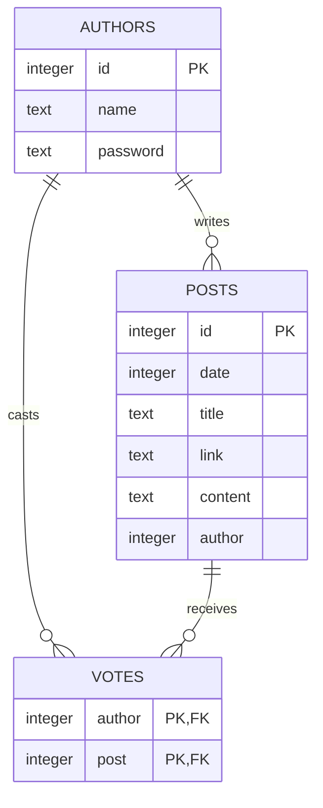

# ER model: Sicheong

Sicheong stores short link posts written by authors. Authors can vote for posts, so the model has one many-to-many relationship, implemented as the `votes` join table.

## Diagram

## Entities

| Table     | Primary key      | Foreign keys                                                     | Purpose                                      |
| --------- | ---------------- | ---------------------------------------------------------------- | -------------------------------------------- |
| `authors` | `id`             | none                                                             | Users who log in and write posts             |
| `posts`   | `id`             | none declared                                                    | A post with a title, link, content, and date |
| `votes`   | `(author, post)` | `author` references `authors(id)`, `post` references `posts(id)` | One row per author-post vote                 |

## Relationships and cardinality

- **Author to posts (one-to-many):** one author writes many posts. Each post has exactly one author.
- **Author to posts through votes (many-to-many):** an author can vote for many posts, and a post can receive votes from many authors. The `votes` table resolves this. The composite primary key stops the same author voting twice for the same post.
- **Post to votes (one-to-many):** a post can have many votes.

## Keys and indexes

- Primary keys: `authors.id`, `posts.id`, and `(votes.author, votes.post)`. The composite key also serves lookups by author.
- `posts_author_idx` on `posts(author)`: finds all posts by one author, used for the author filter.
- `votes_post_idx` on `votes(post)`: counts votes for one post.

## Known limitations

- `posts.author` has no foreign key declared. The link from posts to authors is only enforced by the application.
- The foreign keys on `votes` are declared but not enforced. SQLite only checks them when the `foreign_keys` setting is on, and it is not on yet. The application checks ownership and existence in code instead.
- Deleting a post does not yet delete its votes. The cascade is not in place, so vote rows can be left behind.
- Passwords are stored in plain text. Hashing is planned but not implemented yet.
